<p align="center">
  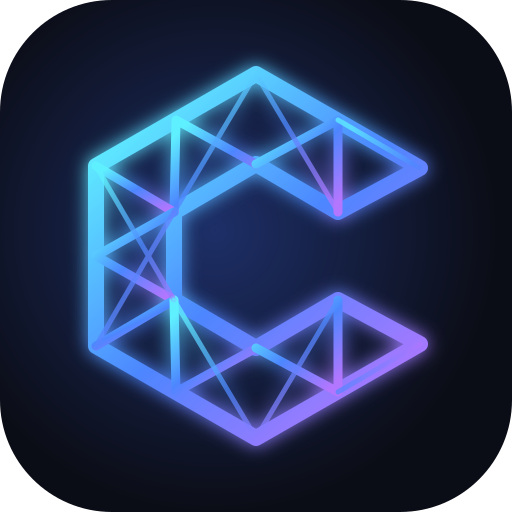
</p>

<h1 align="center">Crystal</h1>

<p align="center">
  Una app para organizar toda tu vida en un solo sitio: calendario, tareas, hábitos, clase, gimnasio, finanzas, viajes y recuerdos.<br>
  Se instala en el PC y en el móvil y funciona sin internet.
</p>

<p align="center">
  <a href="https://crystal-6cp.pages.dev"><b>Abrir Crystal</b></a> ·
  <a href="#capturas">Capturas</a> ·
  <a href="#qué-incluye">Qué incluye</a> ·
  <a href="#cómo-arrancarla">Cómo arrancarla</a>
</p>

<p align="center">
  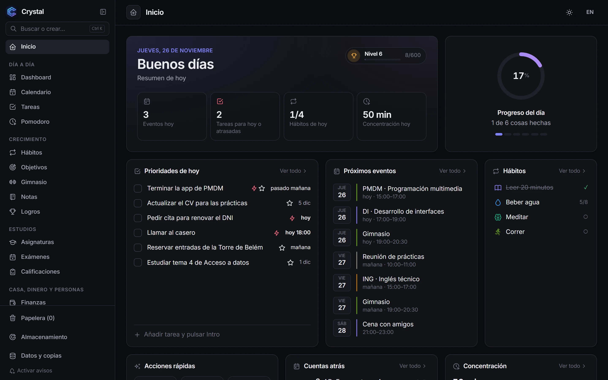
</p>

## Qué es

Crystal es mi proyecto personal del ciclo de **DAM** (Desarrollo de Aplicaciones Multiplataforma). Es como un ERP o CRM, pero para la vida diaria. En vez de tener una app para el calendario, otra para el gimnasio y otra para los gastos, todo está en el mismo sitio y conectado. Por ejemplo, los exámenes salen en el calendario, los viajes tienen su presupuesto y los entrenamientos suman puntos en los logros.

- **PWA**: se abre en el navegador y se instala en Windows y Android como una app normal.
- **Funciona sin conexión**: los datos se guardan en el propio dispositivo (IndexedDB).
- **Cuentas opcionales** con Supabase, con un panel de administración.
- **Español e inglés**, con tema oscuro y tema claro.

## Capturas

> Las capturas usan datos de ejemplo inventados.

<table>
  <tr>
    <td width="50%">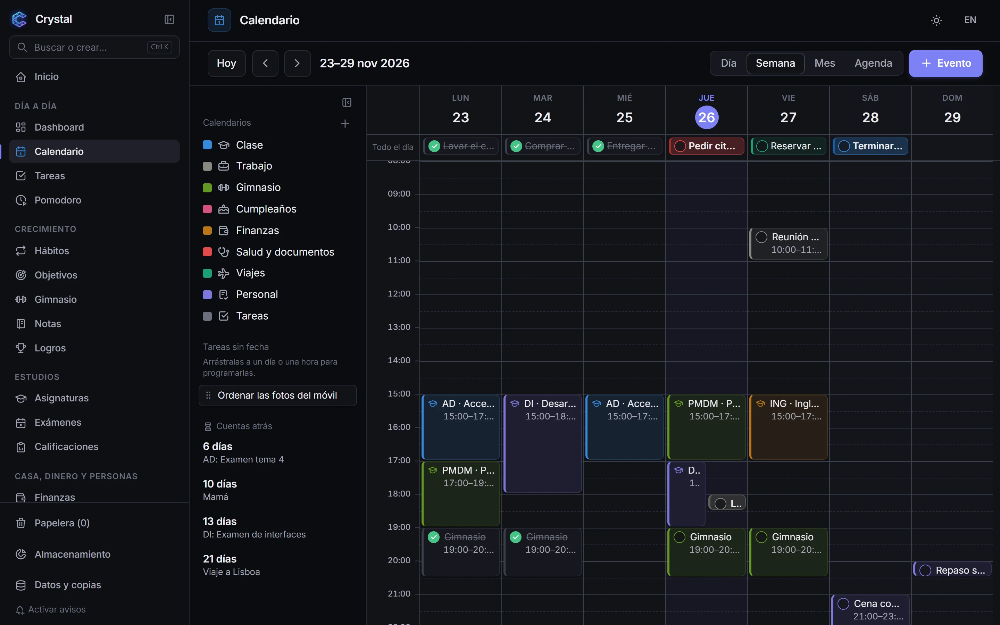<br><sub><b>Calendario</b>: vistas de día, semana, mes y agenda. Los eventos se arrastran para moverlos.</sub></td>
    <td width="50%">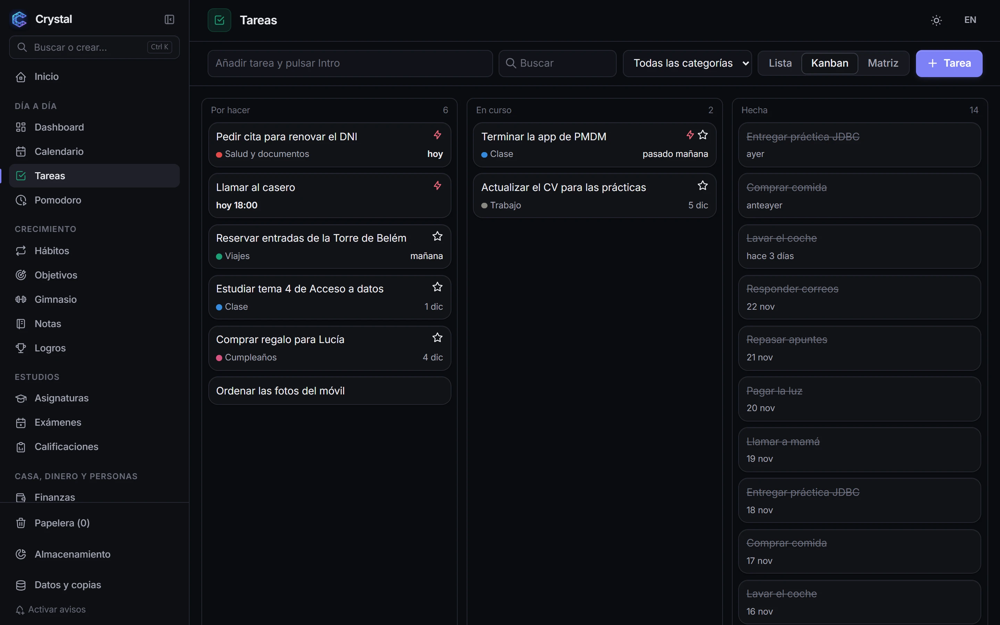<br><sub><b>Tareas</b>: en lista, kanban o matriz urgente/importante.</sub></td>
  </tr>
  <tr>
    <td>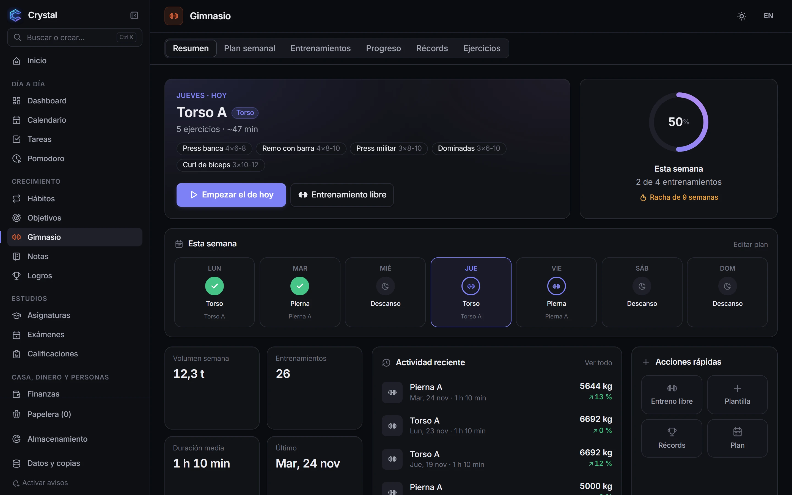<br><sub><b>Gimnasio</b>: plan semanal, plantillas e historial comparado con la última sesión.</sub></td>
    <td>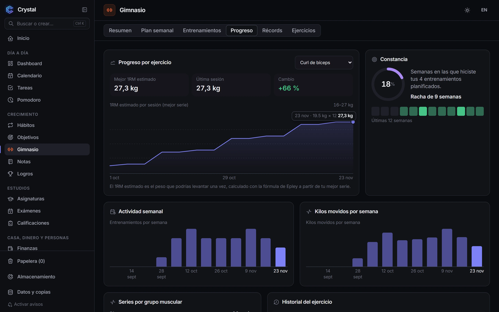<br><sub><b>Progreso</b>: gráficas por ejercicio, constancia y récords.</sub></td>
  </tr>
  <tr>
    <td>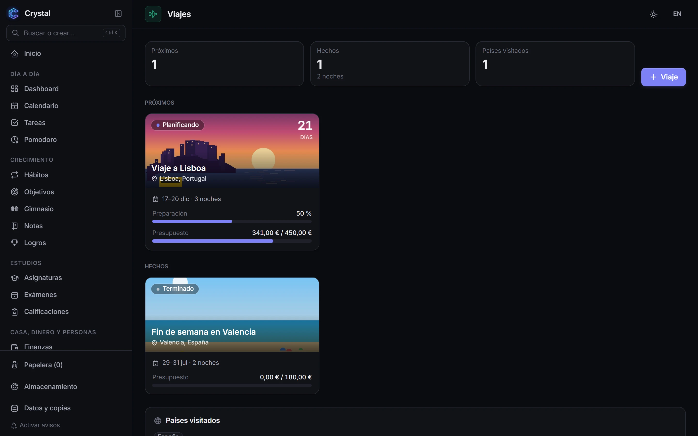<br><sub><b>Viajes</b>: portada, cuenta atrás, presupuesto y preparación.</sub></td>
    <td>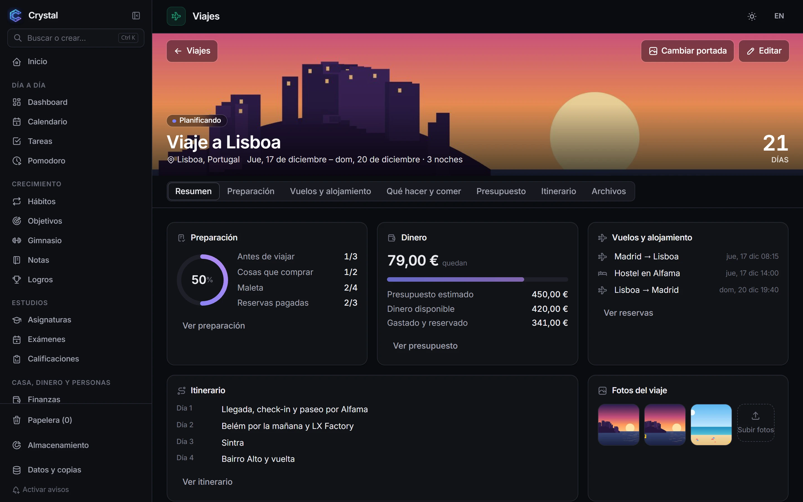<br><sub><b>Dentro de un viaje</b>: vuelos, alojamiento, billetes, planes, itinerario y fotos.</sub></td>
  </tr>
  <tr>
    <td>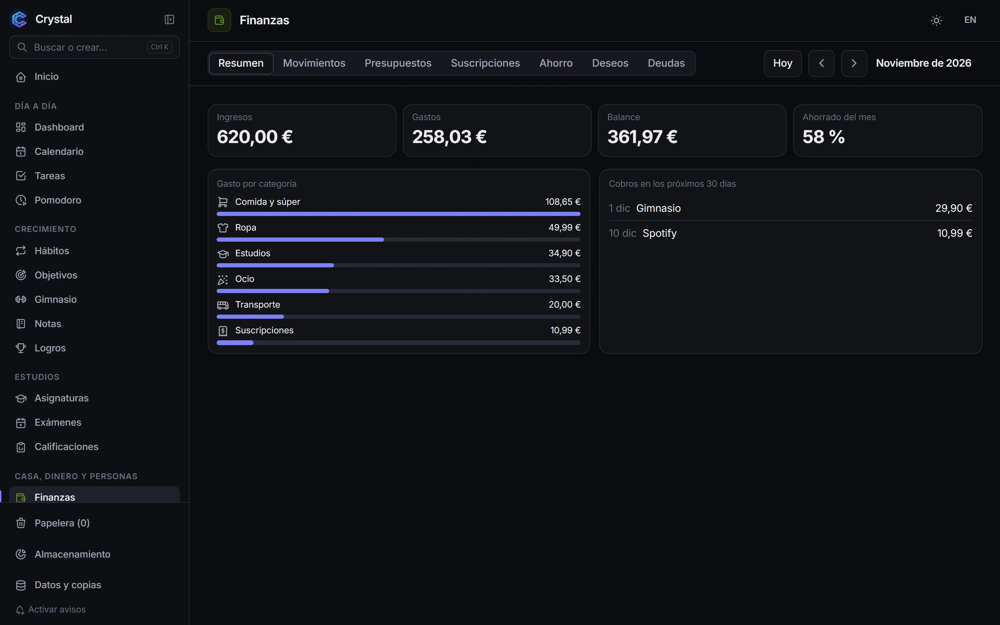<br><sub><b>Finanzas</b>: gastos, ingresos, presupuestos, suscripciones y ahorro.</sub></td>
    <td>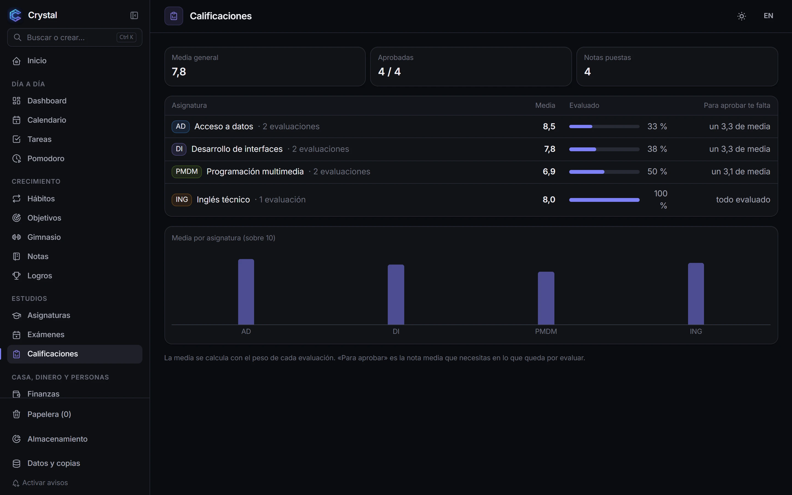<br><sub><b>Calificaciones</b>: media ponderada y la nota que te falta para aprobar.</sub></td>
  </tr>
  <tr>
    <td>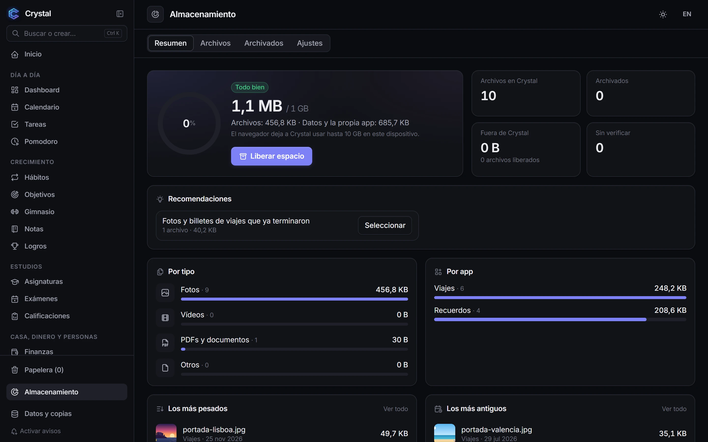<br><sub><b>Almacenamiento</b>: lo que ocupa cada app, avisos y archivado seguro de fotos y PDFs.</sub></td>
    <td>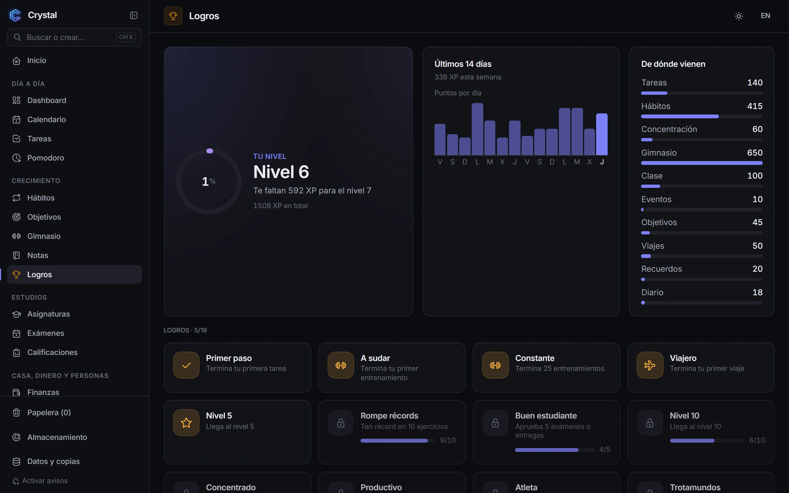<br><sub><b>Logros</b>: puntos y niveles que salen de lo que ya haces en la app.</sub></td>
  </tr>
</table>

**En el móvil y en tema claro**

<table>
  <tr>
    <td width="25%">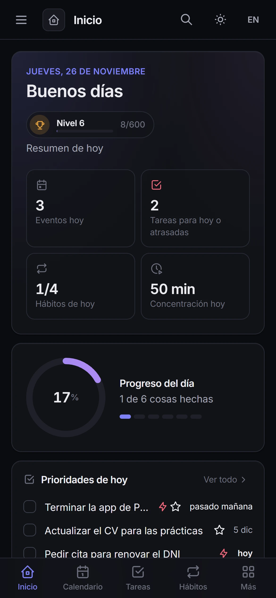</td>
    <td width="25%">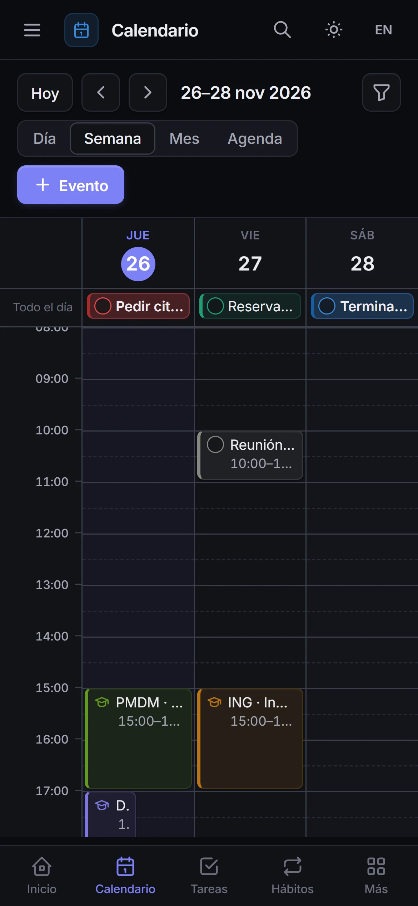</td>
    <td width="25%">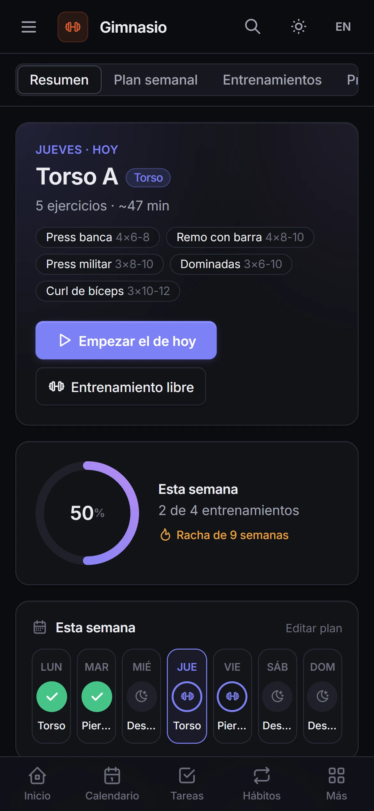</td>
    <td width="25%" valign="top">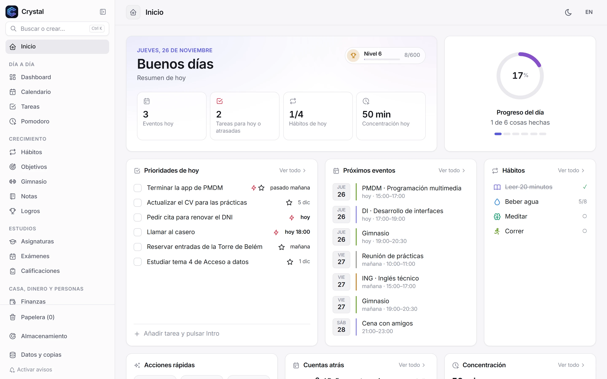<br><sub>Tema claro</sub></td>
  </tr>
</table>

## Qué incluye

**Día a día**
- **Inicio**: resumen del día, progreso, prioridades, próximos eventos, hábitos y acciones rápidas.
- **Dashboard** con widgets que se ordenan y se ocultan.
- **Calendario** con calendarios por colores y eventos que se repiten. Las tareas con fecha y los exámenes también salen en él.
- **Tareas**, **Pomodoro** y un **buscador** con <kbd>Ctrl</kbd>+<kbd>K</kbd> para encontrar o crear cualquier cosa.

**Crecimiento**
- **Hábitos** con rachas, **Objetivos** con pasos y **Notas** con diario.
- **Gimnasio**: rutinas, entrenamiento en curso con temporizador de descanso, aviso de récord, progreso y biblioteca de ejercicios.
- **Logros**: XP, niveles y 19 insignias.

**Estudios**
- **Asignaturas** con horario, **Exámenes** con cuenta atrás y **Calificaciones**.

**Casa, dinero y personas**
- **Finanzas**, **Casa** (lista de la compra y tareas del hogar), **Inventario** (garantías) y **Documentos** (caducidades).
- **Contactos** con cumpleaños e ideas de regalo. Se pueden **importar desde el móvil**: con el selector de contactos de Android o con un archivo `.vcf`.

**Ocio y recuerdos**
- **Viajes**, **Recuerdos** (fotos con fecha y comentario) y **Biblioteca** (libros, series y pelis).

**En toda la app**
- **Archivos adjuntos**: fotos, billetes y PDFs. Las fotos se reducen solas.
- **Papelera** de 30 días, con opción de deshacer al borrar.
- **Avisos** del navegador y **copias de seguridad** (descargar y restaurar).
- **Gestor de almacenamiento**:
  - Un límite que eliges tú, con avisos al 70, 85 y 95 %.
  - Archiva archivos en una carpeta o en un disco externo y los recupera cuando los necesitas.
  - Antes de liberar espacio comprueba la copia con una huella SHA-256 y te pide confirmación. **Nunca borra un archivo sin una copia verificada.**

## Tecnología

| | |
|---|---|
| Interfaz | React 19, TypeScript, Vite 7, Tailwind CSS 4, React Router 7 |
| Datos | Dexie 4 (IndexedDB) y `useLiveQuery`. Todo se guarda en el dispositivo |
| Estado | Zustand (preferencias guardadas en `localStorage`) |
| Idiomas | i18next (`src/i18n/es.json` y `en.json`) |
| App instalable | vite-plugin-pwa (service worker e iconos generados desde `public/logo.svg`) |
| Cuentas | Supabase (autenticación, roles y reglas RLS) |
| Tests | Vitest y fake-indexeddb |
| Publicación | Cloudflare Pages |

## Cómo arrancarla

Hace falta **Node.js 20** o superior.

```bash
npm install        # solo la primera vez
npm run dev        # servidor de desarrollo en http://localhost:5173
npm run typecheck  # comprueba los tipos
npm test           # ejecuta los tests
npm run build      # genera la versión final en dist/
npm run preview    # sirve dist/ para probar la PWA instalable y el modo sin conexión
```

Sin configurar nada, la app funciona **sin cuentas** y guarda los datos solo en ese dispositivo.

### Cuentas (opcional, con Supabase)

1. Crea un proyecto en [supabase.com](https://supabase.com).
2. En **SQL Editor**, pega el contenido de [`supabase/schema.sql`](supabase/schema.sql) y pulsa **Run**.
3. En **Project Settings → API**, copia la *Project URL* y la *anon public key*.
4. Crea el archivo `.env.local` en la raíz. No se sube al repositorio.

   ```
   VITE_SUPABASE_URL=...
   VITE_SUPABASE_ANON_KEY=...
   ```
5. Reinicia `npm run dev`. **La primera cuenta que se registra es la de administrador.**

Cada cuenta tiene su propia base de datos en el dispositivo. El administrador puede bloquear cuentas y ver estadísticas en `/admin`.

### Publicar

```bash
npm run build
npx wrangler pages deploy dist --project-name crystal
```

Si usas cuentas, añade la dirección publicada en Supabase, en **Authentication → URL Configuration**.

## Cómo se guardan los datos

- Todo registro tiene `id`, `createdAt`, `updatedAt`, `deletedAt` y `dirty`.
- Al **borrar**, el registro va a la papelera. Pasados 30 días se elimina y queda una "lápida" para la futura sincronización.
- Todas las escrituras pasan por [`src/db/repo.ts`](src/db/repo.ts), nunca por `db.tabla.put()` directamente.
- Los cambios en la base de datos se hacen con una nueva versión de Dexie y una migración, sin perder datos.

## Estructura

```
src/
  App.tsx        Rutas y diseño general (barra lateral, navegación móvil, buscador, avisos)
  auth/          Entrar, registrarse y perfil
  components/    Piezas compartidas: SidePanel, adjuntos, visor de archivos, gráficas...
  db/            Tipos, base de datos (Dexie), repo, hooks y migraciones
  lib/           Fechas, imágenes, copias, archivado y cálculo del almacenamiento
  modules/       Una carpeta por app, más registry.ts con la lista de apps
  pages/         Inicio, papelera, datos y copias, administración
  reminders/     Avisos del navegador
  store/         Stores de Zustand
supabase/        Esquema de la base de datos en la nube
docs/capturas/   Imágenes de este README
```

La especificación completa está en [`especificacion.md`](especificacion.md).

## Lo siguiente

- [ ] Sincronizar los datos entre el móvil y el PC con Supabase (incluidos los archivos)
- [ ] Avisos push con la app cerrada
- [ ] Conectar con Google Calendar
- [ ] Encontrar fotos repetidas para liberar espacio
